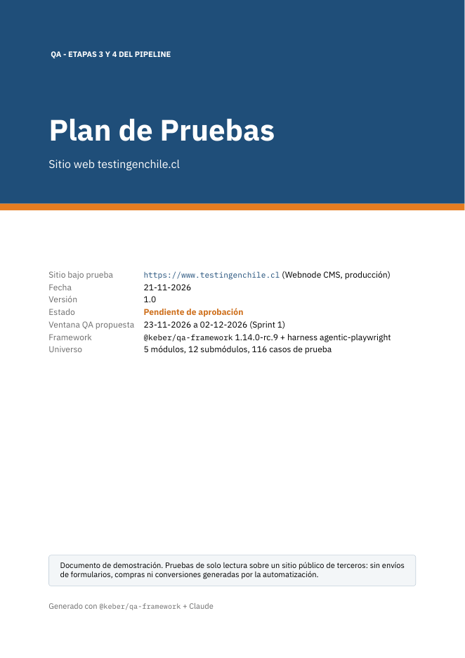

# Demo: qa-framework + Claude aplicado a testingenchile.cl

Este repositorio es una **demostración de las capacidades de
[`@keber/qa-framework`](https://www.npmjs.com/package/@keber/qa-framework)** (versión `next`,
1.14.0-rc.9) aplicado con **Claude** (Claude Code, modelo Opus) al sitio público
[testingenchile.cl](https://www.testingenchile.cl/).

Todo el contenido (configuración, especificaciones, plan de pruebas, automatización Playwright,
healing, defectos, recomendaciones e informes finales en LaTeX/PDF) se generó a partir de **un
único prompt**. No hubo intervención manual en los artefactos: bastó ese prompt para producir
el repositorio completo, incluidos los informes finales.

> Demostración con fines educativos. Las pruebas son de **solo lectura** sobre un sitio de
> producción de terceros: no se envían formularios, se bloquean los rastreadores de terceros y
> se limita el paralelismo a 2 workers. Los resultados reflejan una observación puntual del
> 21-11-2026 y pueden cambiar cuando el sitio se actualice.

---

## El prompt inicial

```text
Crea un nuevo directorio llamado demo_testingenchile, inicializa git, instala y configura el
paquete npm @keber/qa-framework@next en dicha carpeta, configurando como proyecto a testear
https://www.testingenchile.cl/ , sin usuario/contraseña ni sección privada conocidos. Incorpora
las principales características del agentic playwright framework de ivan davidov,
https://github.com/idavidov13/agentic-playwright.

Una vez configurado el framework, coordina sub-agentes modelo Opus 5.5 Medio para que ejecuten
las etapas del pipeline del qa-framework hasta las pruebas end to end con playwright y la etapa
de healing, sin incluir integración con Azure DevOps. Utiliza gitflow y merge --no-ff para ir
actualizando el repo. Una vez finalizada la aplicación del framework, genera los informes de
análisis de pruebas, plan de pruebas y ejecución de pruebas en latex y PDF y añádelos al repo.

Sube el repo a mi github en modo público con el nombre demo-qaframework-saucedemo . Actualiza el
readme para que explique que el propósito del repo es una demostración las capacidades del
qa-framework aplicado con Claude a la web "testingenchile.cl". Incluye el prompt inicial,
indicando que bastó ese prompt para generar el contenido del repo incluyendo los reportes
finales.

Incluye en el readme snapshots de los informes PDF.
```

> Nota: el prompt pedía el nombre `demo-qaframework-saucedemo`, pero ese repositorio ya
> existía con otra demo (saucedemo.com). Para no sobrescribirlo, este se publicó como
> `demo-qaframework-testingenchile`. Fue la única intervención humana: elegir el nombre.

Más tarde, un segundo prompt agregó la ejecución en GitHub Actions y la auditoría de la suite
(sección siguiente):

```text
lanza el workflow E2E en GitHub Actions.
En paralelo, instala el paquete npm @keber/qa-suite-audit@next , y con él audita este repo .
Añade al readme los resultados generales de la auditoría, su origen y propósito; Publica
también la version html del reporte en una github page, e incluye el link en el readme.
```

---

## Resultados en cifras

| Indicador | Valor |
|---|---|
| Módulos / submódulos analizados | 5 / 12 |
| Casos de prueba especificados | 116 (P0: 13, P1: 45, P2: 35, P3: 23) |
| Decisión de automatización | 84 automatizar, 2 manual, 30 pendientes |
| Tests Playwright ejecutados | 119 (116 TCs + 3 smoke del harness) |
| Resultado de la ejecución final | 78 pasan, 9 fallos esperados (defectos), 32 omitidos, **0 fallan, 0 inestables** |
| Pruebas de estabilidad (healing) | `--repeat-each=3` (357 ejecuciones) y `--retries=0`: 0 fallos, 0 flaky |
| Defectos abiertos | 5 (`DEF-TCH-001` a `DEF-TCH-005`: enlaces rotos y textos alternativos faltantes) |
| Recomendaciones | 18 (`REC-TCH-001` a `REC-TCH-018`) |
| Veredicto QA | Aprobado con observaciones |
| Ejecución en GitHub Actions (21-11-2026) | [Run 44938437335](https://github.com/keber/demo-qaframework-testingenchile/actions/runs/44938437335): verde en 3m52s, 117 tests (sin los 2 `@destructive`), 87 pasan (incluye los 9 fallos esperados) y 30 omitidos |

---

## Auditoría de la suite (qa-suite-audit)

**Reporte HTML publicado:** https://keber.dev/demo-qaframework-testingenchile/audit/

### Origen y propósito

Después de generar la suite, se auditó con
[`@keber/qa-suite-audit`](https://www.npmjs.com/package/@keber/qa-suite-audit) 0.1.0 (el tag
`next` pedido no existe en npm; `latest` es la única versión publicada). La herramienta
implementa la
[rúbrica de 7 criterios de Adriana Troche Robles (Calidad sin Humo)](https://calidadsinhumo.com/guias/rubrica-para-juzgar-una-suite-de-tests/)
para juzgar si una suite automatizada realmente sirve. Su propósito es que la auditoría sea
**repetible y basada en evidencia**:

1. Los scripts extraen evidencia del repositorio (`audit/input.json`).
2. Un agente (sub-agente Claude Opus) asigna un nivel a cada dimensión dentro de los límites que
   fija la evidencia y cita esa evidencia (`audit/verdict.json`).
3. Un validador rechaza cualquier veredicto que no esté citado, que se salga de los límites o
   que se haya escrito contra otra evidencia.

La versión 0.1.0 solo lee el repositorio (sin historial de CI), por lo que el máximo
alcanzable es 16 de los 21 puntos de la rúbrica original.

### Resultado general

| Dimensión | Nivel | Lectura del juez |
|---|---|---|
| D1 Oráculo | 2/3 | Los tests muestreados codifican su regla, pero solo 18 de 116 casos registran qué regla los respalda |
| D2 Sensibilidad (eliminatoria) | **0/3** | Fijada por la evidencia: 25% de tests "sin aserciones" (límite 5%) |
| D3 Determinismo | 1/2 | Sin esperas fijas reales, pero `retries: 1` sin justificar y sin medición de flakiness versionada |
| D4 Diagnóstico | 2/3 | Trace, video y screenshot al fallar, 261 `test.step`; los títulos llevan el ID del caso, no el de la regla |
| D5 Cobertura de reglas | 2/2 | Hay casos negativos y de borde; 18 de 120 reglas enlazadas a un test |
| D6 Vida en CI | 0/1 | Fijada por la evidencia |
| D7 Mantenibilidad | 2/2 | Nombres en lenguaje de negocio y capas separadas |
| **Total** | **9/16 - NO PASA** | Eliminada por D2 = 0. El validador marca el veredicto como `VALID` |

**Lectura honesta del resultado:**

- El 25% "sin aserciones" corresponde exactamente a los **32 casos pendientes** cuyo cuerpo es
  solo `skipPending()` (`test.skip` con motivo `PENDING-*`). Los 96 tests activos tienen
  aserciones.
- Aun así, la rúbrica tiene razón en el fondo: un test omitido no puede fallar. Para subir D2
  hay que sacar los pendientes de la suite ejecutable y llevarlos a la documentación, o
  automatizarlos.
- El juez dejó registradas tres limitaciones de la extracción que no cambian el puntaje:
  - D6: no se reconoce que el workflow ejecuta `playwright test`, porque la carpeta se pasa
    como variable de entorno.
  - D3: cuenta `test.setTimeout` como espera fija.
  - D2: no detecta los 9 `expectOpenDefect()`.
- Quedan cuatro preguntas para el equipo, sin responder a propósito:
  - ¿Se mide la flakiness?
  - ¿Hay exclusiones deliberadas de reglas?
  - ¿Existe un pipeline externo?
  - ¿Hay un proceso de revisión y retiro de tests?

Artefactos: [audit/input.json](audit/input.json), [audit/verdict.json](audit/verdict.json),
[audit/report.txt](audit/report.txt), [audit/report.html](audit/report.html).

---

## Informes PDF

| Informe | PDF | Fuente LaTeX |
|---|---|---|
| Análisis de Pruebas (12 págs.) | [informe-analisis-de-pruebas.pdf](reports/analisis-de-pruebas/informe-analisis-de-pruebas.pdf) | [.tex](reports/analisis-de-pruebas/informe-analisis-de-pruebas.tex) |
| Plan de Pruebas (19 págs.) | [plan-de-pruebas.pdf](reports/plan-de-pruebas/plan-de-pruebas.pdf) | [.tex](reports/plan-de-pruebas/plan-de-pruebas.tex) |
| Ejecución de Pruebas (16 págs.) | [informe-ejecucion-de-pruebas.pdf](reports/ejecucion-de-pruebas/informe-ejecucion-de-pruebas.pdf) | [.tex](reports/ejecucion-de-pruebas/informe-ejecucion-de-pruebas.tex) |

### Informe de Análisis de Pruebas

<p>
  
  
</p>

### Plan de Pruebas

<p>
  
  
</p>

### Informe de Ejecución de Pruebas

<p>
  
  
</p>

---

## Cómo se construyó

Un agente orquestador (Claude Code) instaló y configuró el framework y luego coordinó
sub-agentes Opus (esfuerzo medio), uno por etapa del pipeline. Cada etapa trabajó en su propia
rama `feature/*` y se integró en `develop` con `git merge --no-ff`; la versión final se
publicó en `main` mediante una rama `release/*` (gitflow).

```text
Instalación + configuración  ->  feature/agentic-playwright-harness
Etapas 1-2  Análisis + especificaciones  ->  feature/stage-1-2-specifications
Etapas 3-4  Plan de pruebas + casos       ->  feature/stage-3-4-test-plan
Etapa 5     Automatización Playwright     ->  feature/stage-5-automation
Etapa 5b    Healing / estabilización      ->  feature/stage-5b-healing
Informes LaTeX + PDF                      ->  feature/latex-reports
README                                    ->  feature/readme
```

Puedes ver la historia completa con `git log --graph --oneline --all`.

### Qué aporta cada pieza

**`@keber/qa-framework`** (metodología spec-driven):

- Estructura estándar `qa/` y pipeline por etapas con prerrequisitos.
- Set de 6 archivos de especificación por submódulo (inventario, reglas de negocio, flujos,
  roles, datos de prueba, escenarios).
- Reglas de polaridad de aserciones: un test afirma lo que exige la especificación; si el sitio
  no cumple, se usa `test.fail()` más un archivo de defecto, nunca una aserción debilitada.
- Estados válidos de cierre (pasa / fallo esperado con defecto / omitido con motivo
  `PENDING-*`), memoria del agente y verificadores de codificación de caracteres.

**Características incorporadas de
[agentic-playwright](https://github.com/idavidov13/agentic-playwright)** (Ivan Davidov, MIT):

- `AGENTS.md` como "Constitución" del repositorio (reglas MUST / SHOULD / WON'T con ID),
  importado desde `CLAUDE.md`.
- Skill `ai-native-workflow` como punto de entrada único, con propuesta y nivel de confianza
  antes de editar ("pregunta, no inventes").
- Hook `PreToolUse` que bloquea escrituras que violan la Constitución
  (`scripts/enforce-constitution.mjs`, reescrito en Node), también ejecutable en modo `--scan`
  en CI.
- Page objects inyectados como fixtures (`mergeTests`), locators como getters, componentes
  compuestos, enums para rutas y mensajes, datos estáticos `as const`, factories Faker
  validadas con Zod (`z.strictObject`).
- Un único tag de tipo por test (`@smoke`, `@regression`, ...), pasos GIVEN/WHEN/THEN.
- ESLint con `eslint-plugin-playwright` y `--max-warnings 0`, prompt de revisión de PR y
  `AI-WORKFLOWS.md`.

Los puntos donde ambos enfoques chocaban se resolvieron a favor del qa-framework y están
documentados en la sección 11 de [AGENTS.md](AGENTS.md).

---

## Estructura del repositorio

```text
.
├── AGENTS.md / CLAUDE.md / AI-WORKFLOWS.md   Constitución y flujos del agente
├── .claude/                                  Comandos qa-*, reglas, skill y hook
├── .github/                                  Skills del framework, prompt de PR, workflow CI
├── scripts/enforce-constitution.mjs          Enforcer de la Constitución (hook + scan)
├── qa/
│   ├── 01-specifications/                    Análisis y specs por módulo/submódulo
│   ├── 02-test-plans/                        Plan maestro + planes por módulo
│   ├── 05-test-execution/                    Informe de ejecución, healing log, resumen JSON
│   ├── 06-defects/                           Defectos abiertos y recomendaciones
│   ├── 07-automation/e2e/                    Proyecto Playwright (pages, fixtures, tests)
│   └── memory/                               Aprendizajes del agente
├── reports/                                  Informes LaTeX + PDF
└── docs/snapshots/                           Capturas de los informes
```

---

## Ejecutar las pruebas

Requisitos: Node 22 o superior.

```bash
npm install
cd qa/07-automation/e2e
npm install
npx playwright install chromium
npx playwright test          # suite completa (solo lectura, ~6 min)
npx playwright show-report
```

Desde la raíz también están `npm run lint`, `npm run typecheck`, `npm run check:constitution` y
`npm run test:e2e`. No se requieren credenciales: la URL base por defecto es
`https://www.testingenchile.cl` y se puede cambiar con la variable `QA_BASE_URL`.

El workflow de CI (`.github/workflows/qa.yml`) ejecuta lint, typecheck y el scan de la
Constitución en cada push; la suite E2E solo corre manualmente o una vez por semana, para no
generar tráfico innecesario sobre el sitio.

---

## Limitaciones

- Una sola observación (21-11-2026), desde una sola red y con Chromium de escritorio.
- El contenido del sitio (eventos, fechas, sponsors) cambia con frecuencia; algunos hallazgos
  pueden quedar obsoletos.
- 30 casos quedan pendientes (`PENDING-SPEC`, `PENDING-BROWSER`) y 2 son manuales; los envíos
  reales de formularios están fuera de alcance a propósito.
- El plan de pruebas queda pendiente de aprobación humana; los defectos y recomendaciones son
  propuestas para revisión del dueño del sitio, no un juicio definitivo.

## Créditos

- [`@keber/qa-framework`](https://www.npmjs.com/package/@keber/qa-framework).
- [agentic-playwright](https://github.com/idavidov13/agentic-playwright) de Ivan Davidov (MIT),
  cuyas ideas se adaptaron aquí.
- Sitio bajo prueba: [Testing en Chile](https://www.testingenchile.cl/). Este repositorio no
  está afiliado al sitio.
